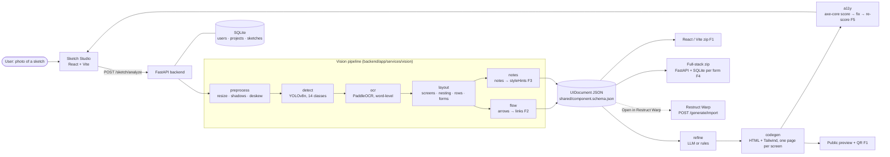
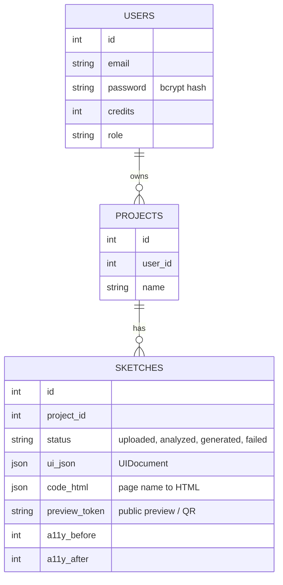
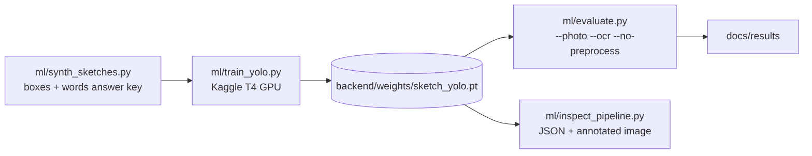

# Architecture

GitHub draws the diagrams below. For the report, paste a block into https://mermaid.live and export PNG/SVG.

## Request flow

Everything after the JSON reads only the JSON. The detector, OCR or LLM can be swapped without
touching code generation, and Restruct Warp can use the same document.

## Data model

The `users` table has the same columns as Restruct Warp's, so one account works in both apps once they share it.

## Training and evaluation

